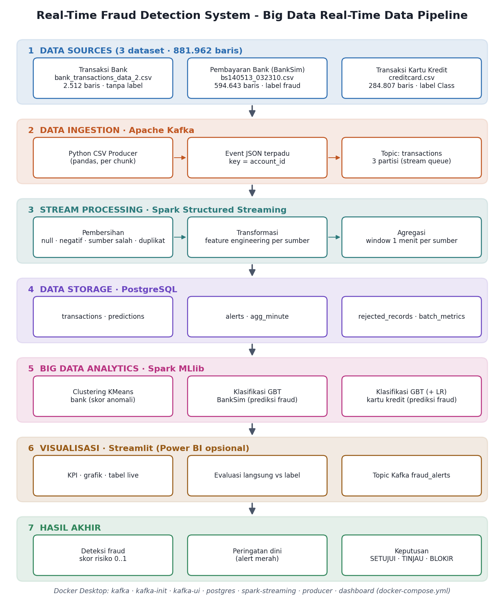

# Real-Time Fraud Detection System

Sistem Big Data yang membaca **file CSV transaksi keuangan (3 dataset)**, mengalirkannya lewat **Apache Kafka** seolah-olah
transaksi masuk secara real-time, memprosesnya dengan **Apache Spark Structured Streaming** (pembersihan →
transformasi → agregasi), mendeteksi transaksi abnormal dengan **Spark MLlib**, menyimpan hasilnya di
**PostgreSQL**, dan menampilkannya di **dasbor Streamlit** lengkap dengan **peringatan dini** dan **keputusan**
(SETUJUI / TINJAU / BLOKIR). Semua layanan berjalan dengan **Docker Desktop** (`docker-compose.yml`).



---

## 1. Dataset

| File | Isi | Baris | Label fraud | Teknik Spark MLlib | Di ZIP? |
|---|---|---:|---|---|---|
| `bank_transactions_data_2-selected-columns.csv` | Kaggle *Bank Transaction Dataset for Fraud Detection* (sintetis, kota-kota di AS, 2023): akun, nominal, lokasi, perangkat, IP, merchant, channel | 2.512 | **tidak ada** | **Clustering** KMeans → skor anomali | ya |
| `bs140513_032310.csv` (**BankSim**) | Simulasi pembayaran bank (Lopez-Rojas & Axelsson, 2014): pelanggan, usia, gender, merchant, kategori belanja, nominal | 594.643 (7.200 fraud) | `fraud` | **Klasifikasi** GBTClassifier | ya |
| `creditcard.csv` | Kartu kredit pemegang kartu Eropa, September 2013 (ULB / Worldline); V1–V28 hasil PCA | 284.807 (492 fraud) | `Class` | **Klasifikasi** GBTClassifier (+ LogisticRegression pembanding) | **tidak** (terlalu besar) – opsional |

**Syarat Manual DIT ≥ 10.000 rekaman terpenuhi:** tanpa `creditcard.csv` = **597.155** rekaman; dengan
`creditcard.csv` = **881.962** rekaman. Sumber yang filenya tidak ada otomatis dilewati.

Yang dialirkan ke Kafka secara default hanya **bagian uji** data berlabel (bukan data latih), agar hasil deteksi jujur:
bank 2.512 + BankSim 133.231 (hari 144–179) + kartu kredit 56.962 (20% waktu terakhir, jika ada).

Semua dataset adalah dataset **publik**, bukan data dari bank tertentu. Jika laporan memakai nama lembaga, tulis
sebagai skenario. Nama di dasbor bisa diganti (tambahkan di `environment` pada `x-app` di `docker-compose.yml`):
`SOURCE_LABEL_BANK`, `SOURCE_LABEL_BANKSIM`, `SOURCE_LABEL_CARD`.

---

## 2. Letak file CSV

```
fraud-detection-realtime/
└── data/
    └── raw/
        ├── bank_transactions_data_2-selected-columns.csv   (sudah ada)
        ├── bs140513_032310.csv                              (sudah ada - BankSim)
        └── creditcard.csv                                   (opsional: ekstrak dari creditcard_csv.zip Anda)
```

Nama dikenali dengan pola `bank*.csv`, `bs140513*.csv` / `banksim*.csv`, `creditcard*.csv`.
Cek: `python scripts/check_data.py` → menampilkan jumlah baris tiap file dan **TOTAL**.

---

## 3. Menjalankan dengan Docker Desktop (dari awal sampai dasbor)

**Prasyarat:** Docker Desktop berjalan, RAM minimal 8 GB (alokasikan ≥ 6 GB di *Settings → Resources*),
internet saat build pertama. Buka PowerShell / Terminal di folder proyek.

```powershell
# 1) build image aplikasi (sekali, ±5–10 menit: Python + Java 17 + PySpark + konektor Kafka)
docker compose build

# 2) (opsional) latih ulang model Spark MLlib. Model terlatih SUDAH ADA di folder models/.
docker compose --profile train run --rm trainer          # ±4 menit

# 3) nyalakan Kafka, PostgreSQL, Spark Streaming, dasbor, Kafka UI
docker compose up -d
docker compose ps                                         # tunggu kafka & postgres "healthy"
docker compose logs -f spark-streaming                    # tunggu: "streaming query started"  (Ctrl+C keluar log)

# 4) mulai mengirim transaksi dari CSV ke Kafka (20 transaksi/detik)
docker compose --profile producer up producer
```

| Alamat | Isi |
|---|---|
| http://localhost:8501 | **Dasbor Streamlit** (KPI, peringatan, tabel live, grafik, evaluasi, kesehatan pipeline) |
| http://localhost:8080 | **Kafka UI**: topic `transactions` (3 partisi), offset, isi pesan; topic `fraud_alerts` |
| http://localhost:4040 | **Spark UI** |
| `localhost:5432` | **PostgreSQL** `frauddb` / `fraud` / `fraud123` (untuk Power BI / DBeaver) |

**Demo peringatan dini** (mengirim 1 transaksi dari dataset, tanpa diubah):

```powershell
docker compose run --rm producer python producer/send_fraud_demo.py --source banksim  # fraud BankSim ASLI (berlabel)
docker compose run --rm producer python producer/send_fraud_demo.py --source card   # fraud kartu ASLI (perlu creditcard.csv)
docker compose run --rm producer python producer/send_fraud_demo.py --source bank   # transaksi bank paling anomali
```

Beberapa detik kemudian muncul kotak merah **"PERINGATAN DINI - FRAUD TERDETEKSI"** di dasbor. Model BankSim
memblokir ±79% dan model kartu kredit ±69% fraud pada data uji, jadi tidak setiap fraud yang dikirim akan terblokir
(sebagian masuk TINJAU).

**Berhenti / mengulang:**

```powershell
docker compose down                     # hentikan semua (data PostgreSQL tetap)
docker compose down -v                  # hentikan + hapus data PostgreSQL
docker compose run --rm dashboard python storage/db.py --reset    # kosongkan tabel saja
```

Opsi producer: `--rate 50`, `--limit 5000`, `--sources banksim` (satu sumber), `--mix bank=1,card=3,banksim=3`,
`--split all` (kirim semua baris, termasuk data latih), `--loop` (ulang terus).

---

## 4. Apa yang terjadi di setiap tahap

| # | Tahap | File | Penjelasan |
|---|---|---|---|
| 1 | Data Sources | `data/raw/*.csv`, `common/events.py` | Setiap baris dari setiap CSV dipetakan ke **satu format event JSON** (event_id, source, account_id, amount, tx_type, channel, location, label, fitur numerik `num`, atribut `attr`). |
| 2 | Data Ingestion | `producer/csv_producer.py` | Membaca CSV, mencampur sumber-sumber, memberi `event_time` saat ini, lalu mengirim ke topic Kafka **`transactions`** (3 partisi, key = `account_id`). Sengaja juga mengirim ±1% **data rusak bertanda** dan ±0,5% **duplikat** untuk menguji pembersihan. |
| 3a | Pembersihan | `spark_jobs/streaming_job.py` | Menolak JSON rusak, `event_id` kosong, sumber tak dikenal, nominal kosong/negatif, waktu tidak valid → `rejected_records` (dengan alasan). Duplikat `event_id` dibuang. |
| 3b | Transformasi | `spark_jobs/features.py` | BankSim: rasio terhadap rata-rata pelanggan, z-score, usia, gender, kategori & merchant (one-hot). Kartu: log nominal & jam dari `Time`. Bank: rasio terhadap rata-rata akun, z-score, lokasi baru, perangkat/IP dipakai banyak akun, channel. |
| 3c | Agregasi | `streaming_job.py` (query 2) | Window **1 menit** per sumber dengan watermark: jumlah transaksi, total/rata-rata/maks nominal, fraud berlabel → `agg_minute`. |
| 4 | Data Storage | `storage/schema.sql` | PostgreSQL: `transactions`, `predictions`, `alerts`, `agg_minute`, `rejected_records`, `batch_metrics`, view `v_scored`. |
| 5 | Big Data Analytics | `spark_jobs/train_models.py` | **Klasifikasi** GBTClassifier (BankSim, kartu) → probabilitas fraud; **Clustering** KMeans (bank, tanpa label) → jarak ke pusat cluster = skor anomali. Analisis deskriptif & tren ada di dasbor. |
| 6 | Visualisasi | `dashboard/app.py` | Streamlit, segar otomatis tiap 3 detik. Power BI bisa terhubung ke PostgreSQL (view `v_scored`). |
| 7 | Hasil akhir | `alerts`, topic `fraud_alerts` | Skor 0..1 + **keputusan**: `APPROVE` (AMAN-SETUJUI), `REVIEW` (MENCURIGAKAN-TINJAU), `BLOCK` (FRAUD-BLOKIR) + alasan. |

**Aturan keputusan:**
- BankSim & kartu kredit: skor ≥ ambang BLOKIR → BLOCK; skor ≥ ambang TINJAU → REVIEW; selain itu APPROVE.
  Ambang dipilih pada data **validasi**: BLOKIR = F1 maksimum; TINJAU = menangkap ≥90% fraud, maks. ~0,5% transaksi
  normal. BankSim: BLOKIR 0,267 / TINJAU 0,137. Kartu: BLOKIR 0,611 / TINJAU 0,027.
- Bank: tanpa label, jadi hasilnya **anomali, bukan fraud yang terbukti** → jarak ≥ persentil 97,5 → REVIEW,
  **tidak pernah BLOKIR otomatis**.

---

## 5. Hasil (FACTUAL - dari eksekusi nyata)

### Model Spark MLlib (`docs/results/model_evaluation.json`)

Data berlabel dibagi menurut **waktu**: latih → validasi (memilih ambang) → uji (angka di bawah).
BankSim: hari 0–107 / 108–143 / 144–179. Kartu kredit: 60% / 20% / 20% waktu terakhir.

| Sumber | Model | Data uji | ROC-AUC | PR-AUC | BLOKIR: precision / recall / F1 | TINJAU+BLOKIR: precision / recall |
|---|---|---|---:|---:|---|---|
| BankSim | GBTClassifier | 133.231 (1.440 fraud) | 0,996 | 0,837 | 0,790 / 0,790 / 0,790 | 0,693 / 0,879 |
| BankSim | aturan sederhana (pembanding): kategori berisiko ATAU nominal ≥ 500 | sama | – | – | 0,196 / 0,793 / 0,314 | – |
| kartu kredit | GBTClassifier (dipakai) | 56.962 (75 fraud) | 0,955 | 0,718 | 0,881 / 0,693 / 0,776 | 0,193 / 0,800 |
| kartu kredit | LogisticRegression (pembanding) | sama | 0,983 | 0,735 | 0,962 / 0,667 / 0,787 | – |
| bank | KMeans (k=4, silhouette 0,376) | 2.512, tanpa label | – | – | 63 transaksi (2,51%) ditandai TINJAU | – |

Model GBT BankSim jauh lebih baik daripada aturan sederhana (F1 0,79 vs 0,31: alarm palsu turun dari 4.696 ke 302).
Pada kartu kredit, regresi logistik sedikit lebih baik pada F1 (0,787 vs 0,776); keduanya dilaporkan apa adanya.

### Uji streaming end-to-end (`docs/results/streaming_run_file.json`)

Dijalankan dengan **sumber file** (`--source file`, tanpa Kafka), Spark lokal, PostgreSQL 16, 3 dataset,
4.000 transaksi pada 30 transaksi/detik + 3 transaksi demo:

| Ukuran | Hasil |
|---|---|
| Tersimpan | 4.003 transaksi (BankSim 1.680, kartu 1.730, bank 593) |
| Ditolak pembersihan | 38 (semua data rusak bertanda): event_id kosong 11, nominal negatif 10, nominal kosong 9, sumber tak dikenal 8 |
| Duplikat dibuang | 28 |
| Latensi (producer → tersimpan) | median 3,5 s · p95 5,8 s |
| Waktu proses per micro-batch | rata-rata 1,6 s |
| BankSim: 17 fraud berlabel | 12 BLOKIR + 3 TINJAU tertangkap, 2 lolos; 3 alarm palsu di BLOKIR |
| Kartu: 1 fraud berlabel | 1 BLOKIR; 1 alarm palsu di BLOKIR, 17 transaksi normal masuk TINJAU |
| Bank | 11 dari 593 ditandai TINJAU |

**Belum diuji di lingkungan pengembangan:** jalur **Apache Kafka** dan **Docker** (lingkungan pembuatan tidak bisa
mengunduh Kafka/image Docker). Kode Kafka memakai API standar (Spark `format("kafka")`, `kafka-python`) dan
`docker-compose.yml` lolos `docker compose config`, tetapi jalankan sekali di laptop sebelum presentasi. Setelah
berjalan dengan Kafka, buat laporan: `docker compose run --rm dashboard python scripts/report_run.py --source kafka`.

---

## 6. Menjalankan tanpa Docker (opsional)

Butuh Python 3.11/3.12 dan PostgreSQL lokal; Kafka opsional (ada mode file).

```powershell
python -m venv .venv ; .venv\Scripts\activate
pip install -r requirements.txt                   # termasuk Java 17 via paket pip jdk4py
python storage/db.py --init
python spark_jobs/streaming_job.py --source file   # terminal 1 (tanpa Kafka)
python producer/csv_producer.py --sink file        # terminal 2
streamlit run dashboard/app.py                     # terminal 3
```

Dengan Kafka di Docker (`docker compose up -d kafka kafka-init postgres`), jalankan tanpa `--source file` /
`--sink file`; program di laptop memakai `127.0.0.1:9094`.

## 7. Menghubungkan Power BI (opsional)

Power BI Desktop → *Get Data* → *PostgreSQL database* → `localhost:5432`, database `frauddb`, user `fraud` /
`fraud123` → view **`v_scored`**, tabel `alerts`, `agg_minute`. Gunakan *DirectQuery* agar ikut diperbarui.

## 8. Struktur proyek

```
fraud-detection-realtime/
├── docker-compose.yml          # kafka, kafka-init, kafka-ui, postgres, trainer, spark-streaming, producer, dashboard
├── docker/Dockerfile           # Python 3.11 + Java 17 + PySpark 3.5.3 + konektor Spark-Kafka
├── config.py                   # konfigurasi (bisa diganti lewat environment)
├── common/events.py            # format event terpadu + pemetaan setiap CSV
├── producer/csv_producer.py    # CSV -> Kafka (real-time)
├── producer/send_fraud_demo.py # kirim 1 transaksi untuk demo
├── spark_jobs/features.py      # feature engineering bersama (training & streaming)
├── spark_jobs/train_models.py  # Spark MLlib: GBT, LogisticRegression, KMeans + evaluasi
├── spark_jobs/streaming_job.py # Spark Structured Streaming: bersihkan, transformasi, agregasi, skor, simpan, alert
├── storage/schema.sql, db.py   # PostgreSQL
├── dashboard/app.py            # Streamlit
├── models/                     # model terlatih (siap pakai)
├── docs/architecture.png       # diagram arsitektur
├── docs/results/               # hasil evaluasi (JSON)
├── scripts/                    # check_data, report_run, make_diagram
├── tests/                      # pytest (6 test)
└── data/raw/                   # file CSV (bank & BankSim sudah ada; creditcard opsional)
```

## 9. Masalah umum

| Gejala | Solusi |
|---|---|
| `spark-streaming` restart terus | `docker compose logs spark-streaming`. Biasanya RAM Docker kurang atau model belum ada (jalankan trainer). |
| Dasbor "Belum ada transaksi" | Producer belum dijalankan (langkah 4), atau Spark belum "streaming query started". |
| Producer: sumber dilewati | File CSV sumber itu tidak ada di `data/raw/`. Jalankan `scripts/check_data.py`. |
| Port 5432/8080/8501 sudah dipakai | Matikan aplikasi lokal yang memakai port itu, atau ubah port di `docker-compose.yml`. |
| Program di laptop tidak bisa ke Kafka | Pakai `127.0.0.1:9094` (bukan `localhost`) - nilai default di `config.py`. |

## 10. Keterbatasan

- Data publik/simulasi; hasil tidak mewakili kinerja pada data bank sungguhan.
- Dataset bank tanpa label: hanya deteksi anomali, akurasinya tidak bisa dihitung.
- BankSim adalah data simulasi; pola fraud-nya (kategori tertentu, nominal besar) lebih mudah dikenali daripada fraud nyata.
- Fraud sangat jarang (kartu 0,17%, BankSim 1,1%), sehingga dalam demo singkat hanya muncul beberapa fraud asli.
- Spark berjalan dalam mode lokal di satu container (bukan cluster multi-node).
- Sistem memberi peringatan dan rekomendasi keputusan; sistem tidak menjamin pencegahan fraud 100%.
